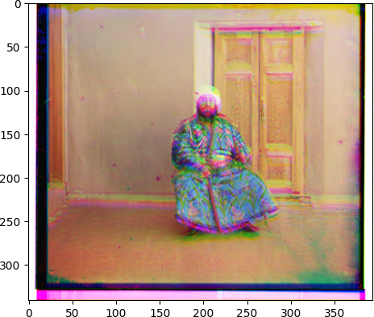
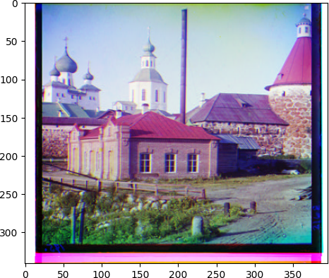
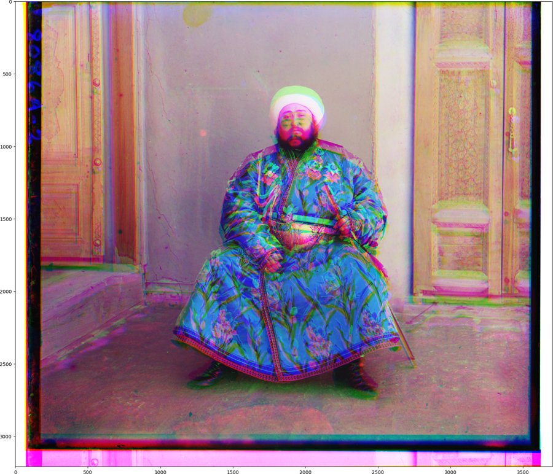
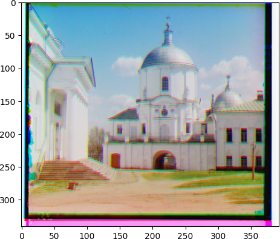
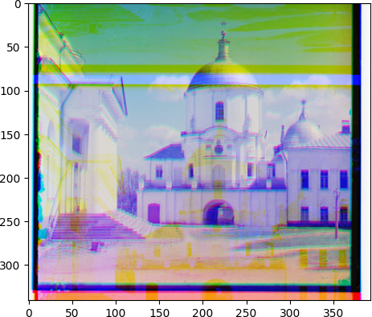

# RGB plate alignment (Prokudin-Gorskii collection)

Sergei Prokudin-Gorskii photographed the Russian Empire around 1907–1915 by exposing one glass plate three times through blue, green and red filters. The Library of Congress scans are single tall grayscale images with the three plates stacked top to bottom. This project splits a scan into its three plates, finds the displacement that lines each plate up with the red plate, and stacks them into a colour photograph.

Everything except image I/O and resizing is written with NumPy. The alignment code is mine; the task comes from a Northeastern CS 5330 (Pattern Recognition and Computer Vision) assignment adapted from Alexei Efros (UC Berkeley) and Subhransu Maji (UMass Amherst). The course notebook scaffolding and dataset are not included here.

## How it works

1. `split_raw_image` cuts the scan into equal thirds and returns the plates in R, G, B order (they are stored B, G, R from the top).
2. `normalized_cross_correlation` flattens two plates to vectors, divides each by its L2 norm, and returns the dot product. Identical plates score 1.0.
3. `get_best_displacement` rolls one plate over every integer offset in a ±15 px window (961 candidates) and keeps the offset with the highest NCC.
4. `get_best_displacement_pyramid` builds a 4-level image pyramid (each level is half the size of the previous one), runs the full ±15 px search only on the smallest level, then at each finer level doubles the displacement and refines it within ±2 px (25 candidates per level). This is what makes a 9627×3702 scan tractable.
5. `get_color_image` aligns G and B to R with the chosen search and stacks them into an RGB image.

## Results

All six course images (`*v.jpg`, 1024×394 raw scans) on a laptop CPU:

| image | exhaustive G (dx, dy) | exhaustive B (dx, dy) | time | pyramid G | pyramid B | time |
|---|---|---|---|---|---|---|
| 00125v | (1, −4) | (2, −10) | 0.306 s | (1, 0) | (2, −10) | 0.067 s |
| 00149v | (0, −5) | (−1, −9) | 0.307 s | (0, −5) | (−1, −9) | 0.050 s |
| 00153v | (−2, −13) | (−3, −11) | 0.290 s | (−2, −13) | (−3, −11) | 0.047 s |
| 00351v | (0, −9) | (1, −13) | 0.277 s | (0, −9) | (1, −13) | 0.055 s |
| 00398v | (1, 0) | (2, −8) | 0.362 s | (1, 0) | (2, −8) | 0.048 s |
| 01112v | (−1, −8) | (−3, −8) | 0.336 s | (−1, −8) | (−3, 83) | 0.048 s |

The pyramid search is about 5–6× faster and returns the same displacements on four of the six images. On the full-resolution `emir.tif` (9627×3702), which the exhaustive search cannot handle in reasonable time, the pyramid finds G (−9, −116) and B (−17, −107) in 2.34 s.

| 00153v (pyramid) | 00351v (pyramid) | emir.tif (pyramid, downscaled for the README) |
|---|---|---|
|  |  |  |

### Known limitation

On two images the pyramid search lands on a worse answer than the exhaustive search: `00125v` (G channel, dy 0 instead of −4) and `01112v` (B channel, dy 83 instead of −8). On the coarsest level each plate is only about 43×49 px and the dark scan borders dominate the NCC score, so the search locks onto the border instead of the picture; the ±2 px refinement at finer levels cannot escape a bad coarse estimate, and `np.roll` wraps pixels around the edge, which is why an offset like 83 can still score well. Cropping the border before scoring, or using a wider refinement window, would fix this; it is left as is so the results above match the submitted assignment.

| 01112v exhaustive (correct) | 01112v pyramid (wrong B offset) |
|---|---|
|  |  |

## Run it

```bash
pip install -r requirements.txt
python align.py path/to/scan.jpg                 # exhaustive search, prints displacements and time
python align.py path/to/scan.tif --pyramid       # coarse-to-fine search
python align.py path/to/scan.jpg -o colour.png   # also save the result
python -m pytest                                 # synthetic-plate regression checks
```

Scans can be downloaded from the Library of Congress Prokudin-Gorskii collection (https://www.loc.gov/collections/prokudin-gorskii/). The tests in `test_align.py` were added after the course submission; they build a synthetic three-plate scan with a known offset and check that both searches recover it.
